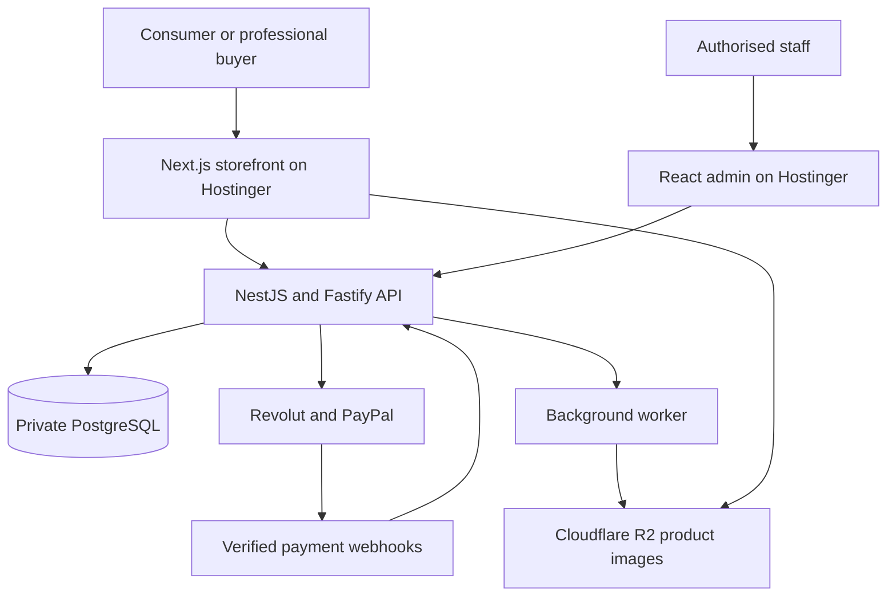

# UK Medical Ecommerce Proposal Draft

Prepared for the owners and commissioned developer of the new medical supplies business. Dated 8 November 2026. Business name and legal operator to be confirmed.

Latest delivery instruction: target the first complete selling journey for Day 25, then implement remaining features. Current client documentation is the [full PDF project plan](../../deliverables/pdf/UK_MEDICAL_ECOMMERCE_PROJECT_PLAN.pdf), with an [HTML handbook](../../deliverables/html/UK_MEDICAL_ECOMMERCE_PROJECT_PLAN.html). Only its [Day 25 roadmap](../../deliverables/pdf/UK_MEDICAL_ECOMMERCE_25_DAY_ROADMAP.pdf) is condensed to one page. The earlier whole-project one-sheet was an assistant misinterpretation. [Launch scope/budget notes](../analysis/23_DAY_25_LAUNCH_SCOPE_AND_BUDGET.md) preserve the assumptions. The broader scope below is not all promised within those 25 days. Launch is conditional on lawful products, ready stock, provider acceptance and passing checks; no fixed-price quote is agreed.

Build a UK medical supplies retailer with its own stock, serving consumers and verified professional/business customers. Use Next.js for the storefront, a separate React admin application, and PostgreSQL. The recommended API is NestJS with the Fastify adapter. Build product approval, purchasing, traceability and channel controls into the core platform so the catalogue can grow without publishing every imported item automatically.

This proposal covers the operating requirements, website scope and release process. The full product-range ambition remains. Individual products and territories become available when their evidence and operating arrangements pass review. Prescription-only medicines remain a separate business decision. This draft supports a client discussion; it is not product-specific legal clearance, a licence application or a fixed-price development contract.

## Confirmed scope and decisions still required

| Area | Confirmed direction | Decision or evidence still needed |
|---|---|---|
| Business | One retailer purchases, owns and holds stock, then sells directly | Legal entity, premises, insurance and stock procedures |
| Buyers | Consumers and verified professional/business customers | Entitlement criteria for each restricted product and account type |
| Range | Full medical supply range, with UK and EU sourcing | Actual SKU list, supplier permissions and category activation sequence |
| Territory | UK first, European expansion later | Whether launch checkout includes Northern Ireland; later destination countries |
| Storefront | Next.js hosted on Hostinger | Rendering, cache and deployment configuration |
| Admin and data | Regular React admin, API and PostgreSQL on Hostinger | API framework acceptance and operational integrations |
| Payments | Revolut, Apple Pay, Google Pay and PayPal; no Stripe | Provider approval of the actual business and catalogue |
| Domain and images | Cloudflare domain and R2; image optimisation during upload | Name, image volumes, variants, retention and delivery configuration |
| Prescription medicines | Undecided | Retail/wholesale activities, authorised operator, personnel, premises and permissions |

The working reference case is a GB-established operator fulfilling from GB. This is an assumption for planning, not a confirmed company or warehouse arrangement. Changing it changes the tax and import analysis.

## Product approval and UK selling requirements

Medical supplies do not follow one universal licence. Classification depends on the actual product, intended purpose, claims, users, destination and the retailer's role in the supply chain. Buying a product from an EU retailer does not establish permission to supply it in GB or Northern Ireland.

| Product route | Required assessment and operating controls | Evidence and scope |
|---|---|---|
| Human medical devices | Establish the applicable UK Medical Devices Regulations 2002 route, conformity evidence, labels, instructions, manufacturer and relevant UK Responsible Person/importer arrangements. Registration is distinct from approval. | [MHRA GB device rules](https://www.gov.uk/guidance/regulating-medical-devices-in-the-uk), [registration guidance](https://www.gov.uk/guidance/register-medical-devices-to-place-on-the-market). GB; checked 8 November 2026. |
| IVDs and diagnostic tests | Assess separately from general devices; distinguish professional use from self-testing. Preserve the manufacturer's permitted purpose and intended user. | Same MHRA sources; GB IVD route, checked 8 November 2026. |
| Devices supplied to Northern Ireland | Review EU MDR/IVDR requirements and the applicable economic-operator, marking and registration arrangements independently. | [MHRA NI device guidance](https://www.gov.uk/guidance/medical-devices-eu-regulations-for-mdr-and-ivdr). NI; checked 8 November 2026. |
| PPE | Verify protective purpose, conformity, marking and operator obligations. Products with both device and PPE purposes can require both routes. | [OPSS PPE guidance](https://www.gov.uk/government/publications/personal-protective-equipment-enforcement-regulations-2018). Separate GB/NI guidance; checked 8 November 2026. |
| Disinfectants and biocides | Determine whether the product is a biocide, device, medicine or another product. For biocides, establish the applicable authorisation or transitional route, permitted claims and labels. | [HSE biocides guidance](https://www.hse.gov.uk/biocides/about/introduction.htm). GB BPR and NI EU BPR; checked 8 November 2026. |
| Human medicines | Separate GSL, pharmacy and prescription-only classifications, product authorisation, patient supply, wholesale supply and import activities. The business needs an activity-specific medicines assessment. | [MHRA classifications](https://www.gov.uk/guidance/medicines-reclassify-your-product), [medicines licensing](https://www.gov.uk/guidance/apply-for-manufacturer-or-wholesaler-of-medicines-licences). UK human medicines; checked 8 November 2026. |
| Veterinary medicines | Assess VMD distribution category, authorised product, premises, professional supply and internet-retailer requirements. Do not apply human pharmacy rules as a substitute. | [VMD internet sales](https://www.gov.uk/guidance/sell-veterinary-medicines-on-the-internet). UK with category and NI qualifications; checked 8 November 2026. |
| Ordinary goods and specialist products | Identify applicable general safety, electrical, chemical, age restriction, transport, installation or waste obligations. Category names do not settle these duties. | Product-specific assessment using [the regulatory analysis](../analysis/06_UK_REGULATORY_FRAMEWORK.md) and [source register](../research/SOURCES.md); baseline checked 7 November 2026. |

For GB devices, CE recognition currently has conditional transition dates: eligible legacy MDD/AIMDD devices to certificate expiry or 30 June 2028, eligible legacy IVDD products to certificate expiry or 30 June 2030, and MDR/IVDR devices to 30 June 2030. Exceptions and transition conditions apply. Store the applicable route and review date for each SKU; an announced consultation on indefinite recognition is not enacted permission. [MHRA transition guidance](https://www.gov.uk/guidance/regulating-medical-devices-in-the-uk), checked 8 November 2026.

The proposed approval record contains the exact SKU/model, manufacturer, pack quantity, intended purpose, regulatory classification, supplier and content rights, conformity/authorisation evidence, destination permissions, buyer restrictions, storage requirements, lot/serial/expiry requirements, reviewer and next review date. Medicines and biocides require their own evidence fields. Keep source documents linked to the reviewed revision.

Imported supplier data enters a draft queue. A change to manufacturer, model, claims, regulatory evidence or supply route triggers another review. The retailer should be able to stop sale immediately and identify affected stock and orders during a recall. Complaints and safety escalation must reach the responsible operator; statutory manufacturer duties must not be silently assigned to an ordinary reseller. [MHRA post-market surveillance scope](https://www.gov.uk/government/publications/medical-devices-post-market-surveillance-requirements/introduction-and-scope), GB devices, checked 7 November 2026.

## Prescription medicines decision

Prescription status is not the same as professional-use status. A restricted device may need an eligible professional buyer without being a prescription medicine. An authorised prescriber is not necessarily a doctor; entitlement depends on the medicine and legal route. [NHS medicines information](https://www.nhs.uk/tests-and-treatments/medicines-information/), UK patient guidance on qualified prescribers, checked 8 November 2026.

The owners need to choose the activities they intend to operate:

| Possible activity | Requirements to establish before implementation and sale |
|---|---|
| Supply prescribed medicines to patients | Appropriate pharmacy/professional supply arrangements, registered premises where required, lawful prescription and dispensing process, identity/safety checks and accountable professional oversight. Assess GB and NI arrangements separately. |
| Supply medicines to clinics or other organisations | Wholesale activity assessment, relevant WDA(H) or applicable exception, authorised premises/personnel, good distribution practice and customer entitlement. A professional account does not by itself authorise supply. |
| Import medicines | Separate import authorisations and responsibilities for the actual origin and route; do not treat an EU purchase as an ordinary device import. |
| Controlled drugs or online prescribing services | Additional specialist assessment, including relevant Home Office and healthcare-service requirements. These are separate scope items, not implied by ordinary ecommerce. |

[MHRA wholesale/manufacturing guidance](https://www.gov.uk/guidance/apply-for-manufacturer-or-wholesaler-of-medicines-licences) and [human medicine import guidance](https://www.gov.uk/guidance/import-a-human-medicine), UK activity-dependent requirements, checked 8 November 2026. Specific exemptions and professional arrangements require specialist confirmation.

Recommendation: model prescription-related restrictions now, but leave prescription-medicine publication, checkout and dispensing disabled until the owners select and substantiate the operating route. This preserves the full-range objective. A prescription upload button cannot replace the required business arrangements. Any future document workflow needs authorised reviewers, private storage, access logs, retention rules and an approved privacy design.

Public advertising of prescription-only medicines is prohibited. Professional promotion has separate requirements; an ordinary business login is not sufficient evidence that an audience is entitled to receive it. [MHRA medicines advertising](https://www.gov.uk/guidance/advertise-your-medicines), UK human medicines, checked 8 November 2026.

## Consumer rights and general ecommerce obligations

Because consumers can buy, the public journey needs clear seller identity, contact/address details, accurate descriptions, payment and delivery terms, cancellation information, order confirmation and a complete price. Consumer-facing prices should include VAT and unavoidable charges; explain variable delivery costs appropriately and show the total before order commitment. A separate professional price view must not mislead consumers. [GOV.UK online selling](https://www.gov.uk/online-and-distance-selling-for-businesses), [CMA price transparency](https://www.gov.uk/government/publications/price-transparency-cma209/providing-clear-and-accurate-information-about-prices-summary), UK consumer sales, checked 8 November 2026.

For goods within the ordinary distance-cancellation rules, consumers generally have 14 days from receipt to notify cancellation and another 14 days to return. Implement applicable refund timing and standard delivery refunds. The sealed health/hygiene exception concerns qualifying goods once unsealed; it is not a blanket medical-goods exclusion. Faulty-goods rights remain separate. Do not impose a universal 48-hour defect deadline or remove statutory rights for discounted goods. [GOV.UK returns guidance](https://www.gov.uk/accepting-returns-and-giving-refunds), UK consumer goods, checked 8 November 2026.

Have the final terms reviewed against the Consumer Contracts Regulations 2013, Consumer Rights Act 2015, Electronic Commerce Regulations 2002 and current unfair-commercial-practices requirements under the Digital Markets, Competition and Consumers Act 2024. The final review must consider exceptions for the actual products and services. Prepare separate consumer/commercial terms, delivery and cancellation policies, complaints process, warranty/service terms and restricted-product rules. Record versions and acceptance.

Use original copy or content with documented permissions. Supplier access does not automatically grant rights to all descriptions, images or branding. For commercial product images, establish a licence or another applicable legal basis for reuse. [UKIPO image copyright guidance](https://www.gov.uk/government/publications/copyright-notice-digital-images-photographs-and-the-internet/copyright-notice-digital-images-photographs-and-the-internet), UK copyright, checked 8 November 2026. Preserve substantiated manufacturer claims and avoid unsupported NHS endorsement, clinical efficacy or lowest-price claims. Product-content permissions form part of supplier approval.

The operational review must also cover imports/customs and EORI, product liability and appropriate insurance, packaging producer responsibility, electrical equipment and battery takeback, dangerous-goods carriage and any installation/service activities. Applicability depends on the actual product and business role. These are tracked in [sourcing](../analysis/07_SUPPLIERS_AND_MIXED_SOURCING.md), [fulfilment](../analysis/09_FULFILMENT_QUALITY_AND_SUPPORT.md) and [governance](../analysis/16_BRAND_AND_GOVERNANCE.md), with dated primary references in the [source register](../research/SOURCES.md). This draft is not a substitute for that activity-specific review.

## Google Merchant Center and campaigns

### Channel eligibility

Google's UK Merchant Center policy excludes prescription and behind-the-counter drug listings. Its UK OTC route requires an online pharmacy registered with the GPhC and certified by Google. Other healthcare products need individual policy review. Google may assess the website and connected accounts as well as feed items; removing a feed item cannot guarantee account approval. [Merchant Center healthcare policy](https://support.google.com/merchants/answer/6150151?hl=en), UK listings, checked 8 November 2026.

Google Ads has separate rules. UK online-pharmacy advertising requires GPhC registration and Google certification and cannot promote prescription drugs in ads or landing pages. Do not transfer Shopping eligibility decisions to Search campaigns or assume provider certification overrides UK law. [Google Ads healthcare policy](https://support.google.com/adspolicy/answer/176031?hl=en), UK online pharmacies, checked 8 November 2026.

### Proposed onboarding process

1. Obtain the old Merchant Center notices and identify affected entities, domains, products and appeal status. A new name is not a remedy for unresolved enforcement; follow the applicable review/appeal process and disclose the operator truthfully.
2. Establish consistent legal identity, domain ownership, contact details, trading information and accurate stock, payment, delivery and returns pages. Do not display licences, reviews or approvals belonging to another operator.
3. Audit the whole launch website and classify each SKU for each intended channel and destination. Default imported items to ineligible until reviewed.
4. Verify/claim the domain and complete the required Merchant Center business, shipping, returns and tax/price settings.
5. Generate a controlled feed of approved, purchasable products. Keep identifiers, pack sizes, prices, availability and landing-page data consistent; use genuine assigned identifiers rather than invented GTINs.
6. Review diagnostics and correct the underlying causes before requesting review. Monitor subsequent supplier changes and policy updates.

[Google misrepresentation policy](https://support.google.com/merchants/answer/6150127?hl=en) and [product data specification](https://support.google.com/merchants/answer/7052112?hl=en), Merchant Center, checked 8 November 2026. Account approval and campaign eligibility are external decisions and cannot be guaranteed in a development contract.

### Proposed campaign sequence

Begin with original product/category SEO and tightly scoped Search and Shopping campaigns for eligible, stocked goods with known margins. Separate budgets by category and buyer intent. Review search terms, landing pages, claims, availability and actual contribution before expanding.

Assess Performance Max only after the product feed and exclusions work reliably. Review URL expansion and automated assets so a campaign cannot introduce restricted landing pages or claims. This is a proposed operating control; it is not a way to conceal non-compliant website content.

Health content is a sensitive category in Google's personalised advertising rules. Do not create audiences from prescriptions, inferred conditions or sensitive product behaviour. Review any remarketing or customer-list use against the current policy before activation. [Google health targeting policy](https://support.google.com/adspolicy/answer/16701855), Google Ads sensitive interests, checked 8 November 2026.

Measure paid orders, refunds, net sales excluding VAT, cost of goods, fulfilment, payment costs and contribution after advertising. Set campaign budgets after real supplier costs and margins are known. No ROAS, acquisition-cost or sales forecast is promised here.

## Privacy and communications

### Customer messaging and retention scope

Add a dedicated communications workstream with transactional email, permission-based email marketing, a preference centre and a support inbox linked to orders. Proposed automations include welcome messages, eligible basket reminders, replenishment suggestions, requested stock alerts and limited reactivation. Approve each journey's content, audience, timing and stop conditions before enabling it.

Keep service messages separate from promotions. The admin should expose communication preferences, permission evidence, suppression status, campaign/product exclusions, template approval, delivery failures and opt-out synchronisation. Use a managed delivery/automation service initially; a full custom campaign editor is a separate scope item. Provider and campaign operation costs belong in the ongoing budget.

WhatsApp remains a feasibility decision because of the policy findings in [customer messaging and retention](../analysis/21_CUSTOMER_MESSAGING_AND_RETENTION.md). SMS, loyalty incentives and referrals are optional scope decisions. Do not assume the former business's customer list can be reused for campaigns without reviewing its provenance, controller identity and permissions.

### Privacy requirements

Apply UK GDPR, the Data Protection Act 2018 and PECR to the actual processing. Document purposes, lawful bases, retention, processor agreements, access controls and international transfers. Prescriptions and other identifiable health information require both an Article 6 lawful basis and an Article 9 condition, plus any associated UK conditions. Do not automatically collect such records for ordinary supplies. [ICO special-category guidance](https://ico.org.uk/for-organisations/uk-gdpr-guidance-and-resources/lawful-basis/special-category-data/what-are-the-rules-on-special-category-data/), UK personal data; checked 8 November 2026 through indexed ICO guidance, direct page access restricted.

Block advertising tracking until valid consent. Assess any permitted statistical-purpose exception against current ICO conditions. Distinguish corporate recipients from sole traders and other individual subscribers for electronic marketing; maintain opt-outs and suppression records. [ICO tracking guidance](https://ico.org.uk/for-organisations/direct-marketing-and-privacy-and-electronic-communications/guidance-on-the-use-of-storage-and-access-technologies/), [ICO B2B marketing](https://ico.org.uk/for-organisations/direct-marketing-and-privacy-and-electronic-communications/business-to-business-marketing). UK; baseline checked 7 November 2026, direct tracking-page refresh blocked on 8 November. Recheck the final implementation with accessible current guidance.

## VAT and financial controls

The UK standard VAT rate is 20%; apply the correct treatment by product and transaction rather than marking the whole medical catalogue VAT-free. The ordinary UK-established registration threshold is taxable turnover exceeding GBP90,000 over the previous 12 months, or expected to exceed that amount in the next 30 days alone. Non-established businesses can face different registration rules. [HMRC VAT rates](https://www.gov.uk/vat-rates), [registration](https://www.gov.uk/register-for-vat), checked 8 November 2026.

Disability relief requires qualifying goods, eligible circumstances/customer and appropriate evidence. Charity-funded medical equipment relief has separate product, recipient and funding conditions. An NHS address, a disability declaration or professional status does not make every purchase zero-rated. [VAT Notice 701/7](https://www.gov.uk/guidance/reliefs-from-vat-for-disabled-and-older-people-notice-7017), [VAT Notice 701/6](https://www.gov.uk/guidance/charity-funded-equipment-for-medical-and-veterinary-uses-notice-7016), UK reliefs, checked 8 November 2026 through HMRC indexed guidance; transaction-specific eligibility needs accountant confirmation.

The admin should maintain tax categories, conditional-relief decisions and evidence references, invoice/credit-note history, landed cost, margin and payment reconciliation. Obtain accountant approval for tax rules, import VAT/duties, mixed baskets and delivery charges. European sales require a separate destination and stock-location assessment; UK VAT configuration is not a Europe-wide solution.

## Proposed software architecture

| Component | Direction | Purpose |
|---|---|---|
| Storefront | Next.js | Searchable product/category pages, consumer and professional journeys, accounts and checkout |
| Admin | React with Vite; TypeScript recommended | Procurement, catalogue, approvals, orders, stock and operational dashboards |
| API | NestJS with Fastify adapter recommended | One authoritative service for eligibility, prices, stock, orders and payments |
| Database | PostgreSQL confirmed; Prisma proposed for data access | Relational records, transactions, constraints and migrations |
| Worker | Separate background process | Upload optimisation, imports, notifications and feed generation |
| Images | Prepared variants in Cloudflare R2 | Optimise once on upload; serve approved public product assets |
| Hosting | Hostinger, with a reverse proxy | Run storefront, static admin, API, worker and database with isolation |

Nest provides a Fastify adapter, and Vite supports React and static production builds. Next.js documents self-hosting behind a reverse proxy and requires attention to cache persistence and multiple instances. These capabilities support the proposed architecture; framework choice alone does not establish performance. [Nest HTTP adapters](https://docs.nestjs.com/techniques/performance), [Vite guide](https://vite.dev/guide/), [Next.js self-hosting](https://nextjs.org/docs/app/guides/self-hosting), official technical documentation checked 8 November 2026.

The admin browser calls the API; it never connects directly to PostgreSQL. Begin with a modular monolith: one application with clear business modules. Separate services can be introduced later if measured needs justify them.

### Advanced admin scope

| Workspace | Proposed capabilities |
|---|---|
| Catalogue and evidence | Variants, pack units, manufacturer identifiers, product documents, content provenance, territory/buyer/channel review, bulk imports with previews and errors |
| Procurement and stock | Suppliers, purchase orders, goods receipt, discrepancies, lots/serials/expiry, quarantine, reservations, adjustments, returns and recall tracing |
| Orders and customers | Consumer/business account types, professional verification, quotes, order holds, partial dispatch, refunds, invoices and customer communications |
| Pricing and finance | VAT-inclusive consumer display, professional pricing, tax rules, landed costs, margin controls and reconciliation exports |
| Marketing and retention | Approved feeds, campaign eligibility, channel preferences, suppression, automation approvals, delivery status and reviewed content |
| Support | Order-linked case history, ownership, returns/complaints, failed-message follow-up and escalation |
| Governance | Staff permissions, MFA, review responsibilities, change history, restricted-document access and export controls |

Use server-side pagination/filtering, indexed queries, bounded exports and background processing. Pilot an intake-to-sale workflow with representative complex products before building every screen. Keep business verification separate from entitlement to buy a particular item and from the legal consumer/business nature of each purchase.

Critical order controls include transactional stock reservations, safe reservation expiry, server-calculated totals, duplicate-request protection, verified payment notifications and reconciliation. Returns must enter an inspection/quarantine workflow where appropriate rather than automatically increasing saleable stock.

Private prescription or verification documents must not share the public product-image delivery path. Optimised public images should have controlled sizes, validated uploads and versioned names; processing jobs should have retries and bounded CPU/memory use.

## Payments and hosting

Revolut documents Apple Pay and Google Pay integrations for businesses with an active Merchant account. Implement the approved wallet flow and required domain/provider configuration, with fallbacks for unsupported customer setups. [Revolut wallet documentation](https://developer.revolut.com/docs/guides/merchant/accept-payments/online-payments/apple-pay-google-pay/introduction), checked 8 November 2026.

PayPal's current UK acceptable-use policy requires approval for prescription items and all items classified as medical devices. Obtain the relevant provider approvals before enabling live methods. Revolut catalogue acceptance also needs confirmation; wallet support alone does not prove acceptance. [PayPal UK acceptable use](https://www.paypal.com/uk/legalhub/paypal/acceptableuse-full), checked 8 November 2026, policy dated 12 October 2026.

KVM 4 is the intended starting server, subject to load testing with the storefront, API, database and worker running together. Define whether 10,000 daily traffic means visitors, sessions or requests and measure peak concurrency, dynamic rendering, search/filter queries and upload workloads. Keep PostgreSQL private, use least-privilege accounts, separate environments, patch regularly, monitor resources and verify off-server backup restoration. One VPS creates a shared outage risk for all hosted services; document a recovery procedure.

Quote ongoing costs separately for hosting and renewal, domain, R2 storage/operations, email, backups, monitoring, payment transactions and maintenance. Earlier Cloudflare-frontend estimates are historical. Development, stock, premises, professional staff, regulatory work and advertising are separate budgets. A final total needs actual scope and provider terms.

Email budgeting must distinguish staff mailboxes, transactional delivery and marketing automation/contact volumes. Add SMS or an eligible WhatsApp use case, support-inbox seats and campaign management separately. Daily website visitors do not establish these messaging volumes.

## Delivery stages and acceptance

| Stage | Deliverable | Acceptance condition |
|---|---|---|
| Business and compliance definition | Legal operator/activity map, product evidence schema, buyer/territory policies and medicines decision paper | Owners name accountable operational reviewers and approve the intended activities |
| Technical validation | Architecture, data model, representative admin workflow and integration proof of concept | Stock, approval and payment-state scenarios work; hosting capacity assumptions are measured |
| Core retailer platform | Storefront, admin, procurement, owned inventory, orders, approved payments and notifications | End-to-end purchase/receipt/dispatch/return and reconciliation scenarios pass |
| Catalogue and launch preparation | Reviewed product data, policies, feed, operational procedures and monitoring | Active products have evidence; rejected cases are blocked; restore/security/access checks pass |
| Controlled launch | Eligible GB/NI products and destinations as approved, limited campaigns and support | Owner release approval, provider acceptance and operational readiness are documented |
| Range and European expansion | Remaining categories and individual country releases | Each category/country passes its own product, tax, fulfilment, language and marketing review |

Phasing controls release order; it does not remove categories from the ultimate range. NI and each European destination require explicit activation rather than a general international-shipping switch.

Before pricing the build, agree the actual first-release backlog, sample product dossiers, import format, warehouse/accounting/carrier integrations, design requirements and migration rights. Estimate delivery after a representative technical pilot. Licence issuance, provider acceptance and Google reviews cannot be promised on the developer's timetable.

## Responsibilities and next decisions

The owners provide the legal operator, procurement authority, supplier/content agreements, professional and regulatory arrangements, stock premises, insurance, tax decisions and operational reviewers. Appropriate legal, pharmacy/regulatory and tax professionals confirm the relevant activities and final policies. The developer implements the agreed controls, integrations, evidence records and acceptance tests; software delivery does not itself authorise medical-product supply.

Resolve these items before committing the launch scope and price:

1. Legal operator and GB/NI delivery scope.
2. First category activation sequence and representative SKU dossiers within the full-range ambition.
3. Prescription-medicines activities and accountable authorised operator, or a decision to defer activation.
4. Supplier/content rights, premises and stock procedures.
5. Revolut/PayPal catalogue approvals and legacy Google enforcement details.
6. API recommendation, operational integrations, budget, maintenance responsibilities and measurable acceptance targets.
7. Campaign/support staffing, permitted customer data, messaging provider and launch automations. Agree optional loyalty/referral features and the integration/handover scope in the [proposal gap review](../analysis/22_PROPOSAL_GAP_REVIEW.md).

Supporting architecture discussion: [API framework and admin architecture](../analysis/20_API_FRAMEWORK_AND_ADMIN_ARCHITECTURE.md). Broader research, specialist scope and remaining evidence gaps: [research source register](../research/SOURCES.md) and [selling parameter register](../analysis/02_SELLING_PARAMETER_REGISTER.md).
